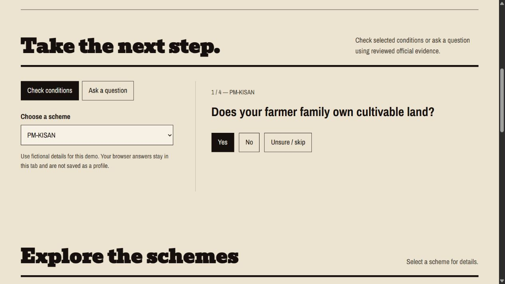

# Yojana Sahayak

[**Try the live demo**](https://tejaspant09.github.io/yojana-sahayak-website/) · [Architecture](docs/ARCHITECTURE.md) · [Verification](docs/VERIFICATION.md) · [Resume notes](docs/PORTFOLIO.md)


Hindi/English government scheme guidance with supporting official sources, selected-condition eligibility checks, and an optional WhatsApp interface. An independent student prototype; the issuing authority makes the final eligibility decision.

This repository belongs to **tejaspant09**. It extends the team's Yojana Sahayak backend with a working browser assistant, owner-specific WhatsApp configuration, and project-local Everything Claude Code (ECC) workflows. See [provenance](docs/PROVENANCE.md).

## Try it without installing anything

The [public website](https://tejaspant09.github.io/yojana-sahayak-website/) lets visitors test the bilingual questions, preliminary condition checks, corrections, citations, and useful refusals. Its reviewed-record engine runs in the browser and uses the same selected-condition semantics as the Node backend. Exhaustive tests cover all 3,780 true/false/unknown profile combinations in Hindi and English. No profile is saved or sent to a model by the public demo.

The full local application adds evidence retrieval with optional model selection and the WhatsApp/voice integration. The public site does not pretend to run an unpaired WhatsApp account or a local model on GitHub Pages.



## Start the browser demo

Requirements: **Node.js 22.12+ (24 recommended)** and npm. No database, API key, or model download is needed for the basic demo.

```powershell
git clone https://github.com/tejaspant09/yojana-sahayak.git
cd yojana-sahayak
npm.cmd ci
npm.cmd run build
npm.cmd start
```

Open **http://127.0.0.1:3000**. On macOS/Linux, use `npm` instead of `npm.cmd`.

1. Choose English or Hindi.
2. Choose a scheme and answer one condition at a time; use **Unsure / skip** where appropriate.
3. Review or change answers, then view a preliminary result and its supporting sources.
4. Choose **Ask a question**, for example “What is the PM-KISAN benefit?”
5. Explore the scheme directory or open the official CSC locator for application assistance.

Browser profiles are held in the current tab, sent to the local API for evaluation, and not persisted. Language preference is saved locally. Use fictional details during demonstration.

For development, `npm.cmd run dev` launches Vite on port 5173 and the API on port 3000.

To reproduce the public build locally:

```powershell
npm.cmd run build:pages
npm.cmd run preview:pages
```

Open the printed `/yojana-sahayak-website/` URL. A push to the [website repository](https://github.com/tejaspant09/yojana-sahayak-website) runs its GitHub Pages deployment workflow. This repository remains the complete source and local-integration reference.

## What works

- Six scheme families: PM-KISAN, PM-KMY, PMUY, PM-SYM, PM Vishwakarma, and NMMSS.
- Bilingual, server-supplied questionnaires, review/correction/skip, missing-condition explanations, and cited preliminary results.
- Retrieval of approved passages with page/section citations and dates. Reviewed fact text is rendered by code; the model can select IDs but cannot supply final factual prose.
- Automatic **extractive fallback** when the optional local model is unavailable. No fake responses are substituted.
- Optional Baileys WhatsApp conversation, multi-scheme comparison, natural-profile confirmation, and voice-note transcription with confirmation.
- Explicit SAVE/RESUME/DELETE commands, encrypted local saved profiles, separate alert consent, bounded queues, and event deduplication in WhatsApp mode.
- Manual official-source monitoring workflow and local update tools. Changed/new information remains pending human review before it can support answers.

Coverage is deliberately limited. Some scholarship dates are quarantined, and sources expire according to `corpus/manifest.json`. Run `npm.cmd run check:release` before every demo; re-review evidence when this gate fails. Do not extend review dates just to make a check pass.

## Optional local AI

Install Ollama separately, then:

```powershell
ollama pull qwen3:4b
```

With Ollama running on port 11434, answers use its bounded fact selection. Without it, the same evidence retrieval returns a reviewed record. Qwen 4B may be too heavy for a 4 GB laptop; the extractive demo needs no model. `/api/ready` reports optional model status separately from core corpus availability.

## Connect your own WhatsApp account

Copy `.env.example` to `.env`. Set `YOJANA_WHATSAPP_NUMBER` to **your own consenting test number**, including country code and digits only. Leave it empty to keep public WhatsApp links disabled.

```powershell
Copy-Item .env.example .env
# Edit .env locally, then:
npm.cmd run whatsapp
```

Scan the displayed QR through WhatsApp's Linked devices, then send `YOJANA START` from another consenting account. Never commit `server/.baileys-auth/` or copy an active session from the team's project. This repository has no paired account bundled.

Baileys is an unofficial WhatsApp Web integration. Phone pairing and end-to-end handset behavior must be checked on your account. This build does not automatically send messages or start the bot.

Optional local speech-to-text:

```powershell
python -m venv .runtime/voice-venv
.runtime/voice-venv/Scripts/python.exe -m pip install -r requirements-voice.txt
```

The worker downloads its configured Whisper model on first use. Voice notes are confirmed before their contents affect the profile. Spoken WhatsApp replies are not implemented. Sarvam is an optional cloud transcription adapter and requires its own key; local transcription is the default.

## Source updates

```powershell
python -m venv .runtime/ingest-venv
.runtime/ingest-venv/Scripts/python.exe -m pip install -r requirements-ingest.txt
.runtime/ingest-venv/Scripts/python.exe scripts/check_sources.py
```

The GitHub **Manual official source review** workflow is started on demand. No recurring GitHub schedule is enabled. See [source governance](docs/SOURCE_GOVERNANCE.md). Set `YOJANA_SOURCE_UPDATES=1` and `YOJANA_PYTHON` to the ingest interpreter only when you want polling while your own bot runs. Alerts remain off by default and require explicit profile consent and `YOJANA_TEST_ALERTS=1` for consenting test delivery.

## Verify

```powershell
npm.cmd test
npm.cmd run build
npm.cmd run check:release
npm.cmd run check:syntax
npm.cmd run test:ingest
```

Python ingestion tests require `requirements-ingest.txt`. The GitHub CI workflow runs the Node tests, browser build, syntax checks, and Python ingestion tests. See [verification evidence and limits](docs/VERIFICATION.md).

## API

| Endpoint | Purpose |
| --- | --- |
| `GET /api/catalog` | Approved fact records, currently supported questionnaires, and optional WhatsApp route |
| `POST /api/chat` | `{ question, language: "en" or "hi", scheme_id? }` |
| `POST /api/recommend` | `{ profile: { scheme_id, ...booleanAnswers }, language }` or a bounded `profiles` comparison |
| `GET /api/health` | Corpus service status |
| `GET /api/ready` | Core readiness, evidence count, optional model availability, and degraded extractive mode |

The default host is loopback. Exposing the API requires `API_ACCESS_TOKEN`, an HTTPS reverse proxy, and an explicit deployment setup. The browser requests the token only if the server requires it and retains it in memory for that tab. Supabase is optional legacy practice scaffolding; the core journey does not need it.

The browser demo is hosted on GitHub Pages. The Node/WhatsApp service runs locally unless separately deployed. Automatic nearest-centre verification, fully autonomous approval of new schemes, beneficiary portal submissions, and production messaging are outside this version.
