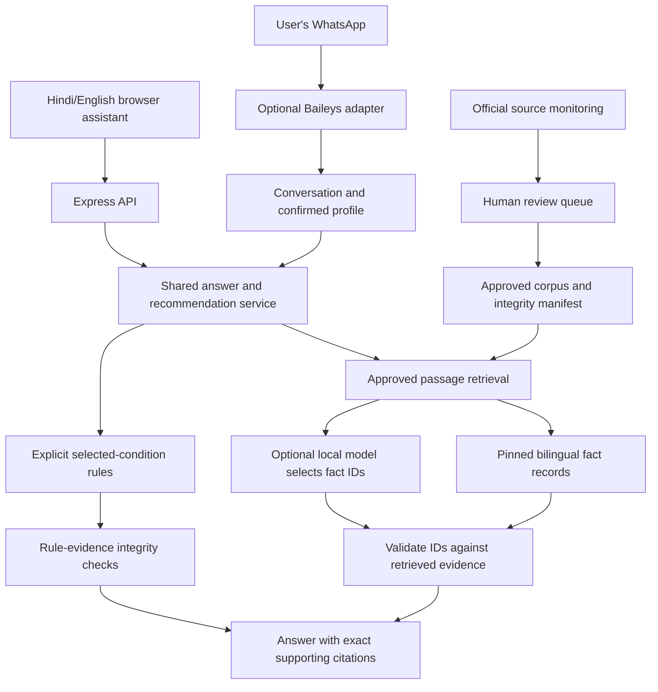

# Architecture

The model is never the authority for eligibility, benefit amounts, dates, links, or translations. It can select bounded, evidence-pinned fact IDs. Final prose comes from reviewed records. If the model is unavailable, a bounded extractive selection uses the same source checks.

The rules engine evaluates explicit boolean answers and preserves unknowns. “Potential match” means the supplied answers satisfy selected conditions, with remaining official checks still necessary. Stored source hashes alone do not establish factual accuracy; review and issuing-authority verification are still needed.

Browser state stays in React memory; only language preference is stored in localStorage. API evaluation does not persist browser profiles. WhatsApp offers explicit SAVE consent, encrypted local storage, expiry, separate alert consent, STOP and DELETE. Authentication and state directories are never served or tracked.

Source fetching, extraction, approval, matching, and alert delivery are separate operations. Fetching new text cannot make it trusted. The on-demand GitHub monitor only produces a review report. Experimental alert delivery rechecks current evidence and consent.

WhatsApp and government-site fetching need internet. Local inference/transcription means processing on the operator's machine, not offline WhatsApp or on-device inference on the beneficiary's phone.
