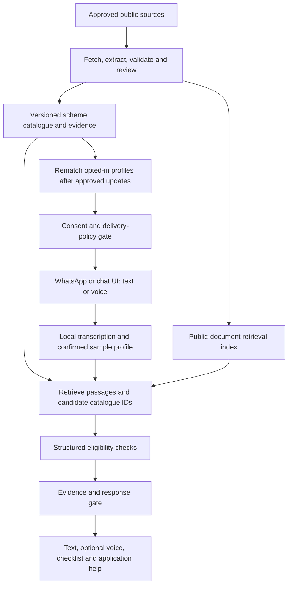

# Yojana Sahayak: product requirements and implementation specification

Version 2.0 | 30 October 2026 | Owner: project captain | Status: implementation handoff

This document consolidates the project owner's discussion, the original INNOVISTA problem statement (PS.pdf, pages 2, 10 and 11), the reported WhatsApp prototype, and the supplied government-source directory. It supersedes earlier conversational MVP suggestions where they conflict with the original problem statement. It specifies work to build; it does not claim that the features, integrations, source records, or tests are already implemented.

Start with [the captain's checklist](README.md), use [the discussion coverage matrix](REQUIREMENTS_TRACEABILITY.md), and keep [the supplied source PDF](references/Yojana_Sahayak_Official_Government_Sources.pdf) with this handoff. [The source registry](source_registry.json) contains all 86 unique URLs extracted from its 91 link annotations, with page references. Directory entries are discovery candidates, not approved scheme facts.

## 1. Outcome and official requirements

Build a Hindi/English assistant that turns public government-scheme documents into understandable, cited answers and helps a person discover potential matches, prepare an application, and obtain optional local assistance.

The original statement requires all three core deliverables:

1. Collect **10 to 20 actual public scheme documents**. A list of URLs, the supplied directory PDF, or ten duplicate downloads does not satisfy this requirement.
2. Implement **real retrieval-augmented question answering in Hindi and English**, using retrieved document passages and naming the supporting source document for each factual answer.
3. Implement an **eligibility questionnaire** using relevant attributes such as age, income, occupation and state to recommend matching schemes.

Optional goals in the statement: voice input/output, additional Indian languages, automatic support checking, and a WhatsApp-style UI. Actual WhatsApp integration, proactive monitoring, local inference and nearby assistance are the owner's chosen extensions. Deliver these without sacrificing the three required core items.

The statement permits other tools and models; it does not require GCP credits. Submission includes a working prototype, a short live demo, readable source/setup instructions, and future ideas. Results must come from the running system, not a scripted answer sequence. Use public documents and **synthetic/sample profile attributes in the hackathon**, never real private eligibility records. Operational WhatsApp identifiers must be minimized, excluded from public fixtures/submissions and not treated as permission to collect real eligibility data.

## 2. Product promise, users and boundaries

Promise: ask in a familiar language, discover a source-backed potential match, understand what is still unknown, and get the next application step.

Users: rural citizens and families; farmers; students seeking scholarships; other occupational groups including engineers; and volunteers/help-desk staff assisting citizens. Roles can overlap: one person can be an engineer, farmer and student. Do not use mutually exclusive audience labels as the entire eligibility engine.

The assistant provides information and preliminary matching. The responsible authority determines eligibility, approves applications and distributes benefits. The bot must never invent a scheme, guarantee approval, claim that every farmer qualifies, or imply government affiliation without authorization.

Scope deliberately excludes automatic government application submission, government login automation, OTP handling, collection of Aadhaar/bank identifiers, benefit payments, guaranteed nationwide coverage, live government application-status integration without an authorized API, or a promise of zero factual error.

## 3. Current prototype: preserve and extend

The owner reports a prototype built in 9-10 minutes:

- `YOJANA START` returns a tiny-demo introduction.
- The introduction suggests `YOJANA PM-KISAN kitna paisa deta hai?` and `YOJANA MATCH yes no no`.
- `YOJANA PM-KISAN` returns a one-source "I do not know" fallback and a PM-KISAN homepage link.

This establishes a reported request/reply milestone. It does not establish retrieval quality, complete eligibility checking, local voice performance, or a particular root cause. Continue the prototype and preserve working messaging. The main branch inspected for this handoff still contains the practice scaffold and an unfilled project brief; the reported live handler was not found there. Locate the captain's actual prototype branch/service before editing application code.

First debugging sequence:

1. Compare the exact advertised benefit question with a scheme-only message and a spelling variant.
2. If only the exact question works, inspect parsing/intent routing. Normalize the command prefix, whitespace, case and known aliases such as PM KISAN/PM-KISAN.
3. If all factual questions fail, check source fetch status, meaningful extracted text, indexed document/chunk counts, selected evidence and refusal reason.
4. Log distinct reasons: unknown_scheme, ambiguous_scheme, missing_intent, unsupported_field, no_evidence, source_fetch_failed, stale_evidence and conflicting_sources.

Known scheme plus no question should return a verified overview and supported next actions, or acknowledge the scheme and ask what the user wants to know. It should not be treated as an unknown scheme merely because a full question is absent. Unknown scheme names must not be completed from model memory.

The sample `MATCH yes no no` command remains a labelled diagnostic shortcut only. Ask named questions in the real flow and retain unknown conditions; three unlabeled booleans cannot establish complete PM-KISAN eligibility.

## 4. Priorities and release gates

| Stage | Deliverable | Exit condition |
|---|---|---|
| A: repair tiny demo | Natural routing, known-scheme overview, meaningful fallback | Advertised question and ordinary aliases behave consistently |
| B: official core (P0) | 10-20 public documents; Hindi and English RAG; questionnaire | Runtime retrieval, evidence citations, and multiple sample personas pass |
| C: useful MVP (P0) | Application checklists, safe replies, saved sample profiles, help locator | One complete sample journey works beyond preset commands |
| D: voice (P1) | Local transcription, then local speech output | Hindi/English tests, number confirmation, text fallback |
| E: updates (P1) | One scheduled source adapter, review queue, version change/rematching | Actual change processing works; simulation is labelled |
| F: alerts (P1) | Opt-in, deduplication, platform delivery checks | Consent, template/window and stale-version checks pass |
| Later | More regions, languages and verified centre partners | Expand only after quality and operations are measured |

Five to ten initial scheme identities may be a manageable pilot, but the final core must still contain 10-20 distinct useful scheme documents. Start with agriculture and scholarship use cases and include other statement examples when appropriate; the document count does not require nationwide coverage. Confirm the pilot state/district before publishing location-specific claims. A sample Maharashtra persona is a test example, not an inference about the user's real location.

## 5. Conversation and interaction contract

### 5.1 Language and onboarding

- Offer Hindi and English at the start; retain a user-selected language and support Romanized Hindi/Hinglish queries where tested.
- Identify the service as an independent information assistant. Explain whether a flow is live, cached or simulated.
- For the hackathon, clearly ask participants to use a sample persona. A future real-user pilot needs separate consent and privacy review before collecting real attributes.
- Ask one question at a time. Allow skip/unknown, correction, restart and access to help. Avoid long forms and unexplained acronyms.
- Keep the YOJANA prefix compatible if it routes a shared demo number; make natural messages work inside an established session. Do not assume every person knows a command syntax.

### 5.2 Profile capture

Start with location and occupation; ask age, income and other attributes only as needed by candidate schemes. Confirm attributes before saving. Record value, units, period, household versus individual scope, confirmation status and profile version. Unknown values stay null/unknown; do not infer caste, disability, income, landholding or gender from a name, voice or occupation.

When a response may change eligibility, ask the relevant missing condition. Numeric income ranges that straddle a threshold cannot be assumed to pass. Record multiple roles. Do not collect precise location when village/district/PIN code is sufficient.

### 5.3 Discovery and scheme detail

Return a few relevant schemes, not a forced fixed number. Each result has an official name, benefit summary, match reasons, missing conditions, application state, source title/link, verification date, and a next step.

For missing evidence: say that the detail cannot be verified from current records. For no matches: state the coverage limitation rather than declaring that no government scheme exists anywhere. Preserve useful partial answers when one field is verified and another is missing.

Example after evidence is accepted: a PM-KISAN benefit answer may explain Rs 6,000 per year in three equal instalments, citing the actual supporting Ministry release [S2]. This is a general benefit fact, not a personal entitlement. Never promise an individual payment date from this information.

### 5.4 Application guidance

Provide the scheme's verified process, responsible authority, official application URL or offline route, mandatory versus conditional documents, and explicit exceptions. Do not invent acceptable replacement documents, universal deadlines, processing times, fees or a portal that accepts every scheme.

Distinguish discovery URL, rules/guidelines URL and application URL; these can differ. myScheme describes redirecting applicants to the responsible department's application page [S1]. Ask whether the user needs nearby assistance after explaining the actual route.

### 5.5 Save/share and progress

Allow a user to reopen or optionally export a sourced checklist/recommendation. Export only the selected content and permitted sample attributes. Keep "interested", "preparing", "user-reported submitted" and "officially approved" distinct. A chat message or locator click is not proof that an application was submitted or approved.

## 6. Source corpus and attached PDF

The PDF is included unchanged in `references/`. Its SHA-256 is `7468d6404b0e5f0d29b58b777fb76a8c7e4d1f544127c05f3a8bc4c12d72684c`. It has 8 pages, 91 URL link annotations and 86 unique target URLs. Readable tables identify resources across national discovery, agriculture, finance, housing, health, education, women/children, employment, MSME, rural development, food distribution, LPG, power, social/tribal welfare, fisheries, sanitation, infrastructure, food processing, textiles and savings.

The machine-readable registry preserves every unique URL with labels, sectors, page references and original directory descriptions. All entries start as `directory_candidate_unverified`, with fetching disabled and no recommendation permission. Some official services use non-.gov.in domains, while some listed resources are general portals or infrastructure programmes rather than directly claimable individual benefits. Neither the PDF title nor a domain suffix establishes current authority, public availability, eligibility or application support.

Bootstrap actions:

1. Use myScheme, India.gov.in and IGOD for discovery and nodal-authority confirmation; data.gov.in is another source suggested by the problem statement.
2. For the agriculture pilot, inspect PM-KISAN, PMFBY and the Agriculture Ministry. For scholarship cases, discover a specific named scheme through NSP and its awarding authority; NSP itself is not one scholarship with a single eligibility rule.
3. Select 10-20 suitable public guideline/FAQ/notification documents for the chosen scheme identities. Do not count the source directory itself as authoritative eligibility evidence.
4. Record access/reuse conditions and the actual document's provenance. Download and hash only permitted public material. Do not bypass authentication or assume a universal schemes API exists.
5. Extract and review facts and rules before approving a live catalogue entry. Store application endpoints separately after verification.

A source may be reachable but outdated, or temporarily unreachable while a verified cached document exists. Apply the freshness policy; do not interpret an HTTP 200 as proof that an application window is open. Direct PM-KISAN homepage access failed during research; the PIB benefit release was accessible. Do not assume the live prototype had the same network failure.

## 7. Ingestion, monitoring and source versioning

Proposed pipeline: source registry candidate -> authority/access review -> allowlisted source adapter -> timestamped snapshot -> text/OCR extraction -> draft fields/rules with evidence -> validation/review -> immutable approved version -> retrieval index -> profile rematching.

Each snapshot stores original URL, redirect destination, issuing authority, title, publication/update date if available, retrieval time, content hash, HTTP/extraction status and a reference to the preserved document. Page/section/table/footnote references must survive extraction. OCR uncertainty must not silently become a precise rule.

Begin with one monitored source and a configurable six-hour polling interval. This is a proposed pilot schedule, not an instant government-publication feed or a claim that every new scheme will be detected. Prefer official feeds/APIs when documented; otherwise use a permitted, rate-limited fetch or manual import.

Detect semantic changes, deduplicate repeated postings and distinguish announcements from operative guidelines. Category extraction may mark a draft for farmers or engineers; detailed applicability still requires rules, exclusions and geography. Newly discovered schemes and changed consequential conditions enter a review queue. Routine collection/matching are automatic; ambiguous new policy interpretation requires review.

Publication states: draft, review_required, approved, rejected, archived. Application states: open, upcoming, closed, unknown. "Approved" is internal content approval. A scheme can exist with a closed or unknown application window.

Publish source, rules, catalogue and index versions consistently; invalidate dependent cached answers, match results and queued alerts. Recheck the accepted version before sending any answer or alert. Review evidence drift, conflict and superseding notices instead of silently combining incompatible versions.

Suggested pilot freshness defaults: recheck application windows/deadlines within 24 hours of using an "open/apply now" claim, and reverify otherwise stable scheme fields within seven days. These are project safeguards, not government update guarantees. Store the policy per field/source; missing publication or current-window evidence remains unknown even after a fresh fetch. If a source cannot meet its applicable policy, suppress the affected recommendation/claim and offer dated historical context only when clearly labelled.

## 8. RAG design



Use the existing stack. A small prototype can use reviewed scheme records in Supabase, a local Chroma/FAISS index or an existing search component, and local multilingual embeddings. Start with a small tested retrieval implementation instead of installing several competing frameworks. Combine location/category filters with semantic/keyword search if it improves the evaluated results; measure rather than assuming hybrid search always wins.

Chunk around meaningful sections and preserve exceptions, table headings and page metadata. Retrieve only approved current evidence. Scheme aliases resolve to existing IDs; text similarity alone cannot approve a scheme. Return zero candidates when necessary. Similarity is relevance, not factual confidence.

The runtime must actually search the corpus and select evidence for unseen questions in both languages. Reviewed factual templates are acceptable rendering mechanisms when populated from the retrieved, validated evidence/records; a hardcoded FAQ transcript or fixed demo sequence alone does not fulfil the RAG requirement.

Keep user profiles and private operational messages outside the shared public-document index. User chat text is not a government source. Do not train the model on submitted user data for the demo.

## 9. Eligibility rules

Use typed rules and explicit logical operators: AND, OR, exclusions, exceptions, date boundaries, geographic coverage, units and household definitions. Preserve the source reference for every rule. Any unsupported rule interpretation makes the affected comparison unverifiable rather than a fabricated yes/no.

Return one of:

- `potential_match`: represented verified mandatory conditions pass on confirmed sample answers, with the limits of coverage stated.
- `needs_information`: a required value is missing, ambiguous or unconfirmed.
- `not_match`: at least one mandatory verified condition fails; explain that condition.
- `cannot_verify`: source conflict, freshness, extraction or unsupported rule logic prevents reliable checking.

Avoid percentage "eligibility probability" as a replacement for rules. Do not reduce a scheme to its occupation tag, assume family definitions are universal, invent exemptions, or imply that checking the represented rules equals official approval. Include all known exclusions before using potential_match.

## 10. Automatic safeguards against fabricated or unsupported answers

The enforceable invariant is: **every delivered scheme identity belongs to the approved catalogue, and every consequential claim comes from an accepted field/evidence version**. This can block out-of-catalogue recommendations; it cannot prove that an incorrectly extracted source interpretation is true. Do not claim universal zero hallucination.

| Control | Required implementation | Failure behaviour |
|---|---|---|
| Origin and links | Allowlisted source URLs and approved application destinations; validate redirects | Quarantine unknown destination |
| Ingestion | Typed facts/rules with passages and review status | Keep unreviewed content out of answers |
| Scheme identity | Server checks known scheme ID, publication status and current version | Reject unknown/unpublished/withdrawn ID |
| Evidence | Verify selected evidence belongs to the scheme and accepted version | Reject mismatched citation/context |
| Critical facts | Server hydrates names, amounts, dates, documents, fees, conditions and URLs from checked fields | Omit or state unknown |
| Eligibility | Explicit rules with unknowns and exclusions | Ask, explain failure, or cannot_verify |
| Output | Approved factual templates; constrained explanatory language | Template or useful refusal |
| Translation/voice | Preserve source facts, units, negations and uncertainty | Confirm or use text fallback |
| Freshness | Recheck state/version immediately before delivery | Recompute or cancel stale response/alert |

LLM output is untrusted structured data. It may propose intent, scheme IDs, evidence IDs and follow-up slots. Validate its JSON/schema and enum values; hydrate facts independently. A natural-language completion cannot create an approved scheme, invent an official URL or override rule results. For open-ended details outside supported fields, quote a short relevant sourced passage or state that the system cannot verify a complete answer; do not expose unrestricted generated claims as if validated.

Do not rely only on a "never hallucinate" prompt, low temperature, keyword filters, an arbitrary similarity threshold or an LLM judge. Secondary models and support scores can assist evaluation but do not constitute proof. Calibrate relevance thresholds on both answerable and unanswerable examples to avoid refusing every question.

Documents and user messages are data, not instructions. Ignore retrieved requests to change policy, fetch arbitrary URLs, reveal secrets, or approve records. Do not render model-generated HTML unsafely. Log evidence IDs, accepted versions and decision codes rather than unnecessary personal content.

## 11. WhatsApp integration

Retain the working provider adapter while its behaviour is inspected. Prefer the official WhatsApp Business Platform for a deployable service. The earlier suggestion of "Baileys" was an exploratory transport idea, not a decision to depend on unofficial WhatsApp Web automation. If an experimental adapter is already used, isolate it and document its limitations; do not present it as official or assume it will be reliable at scale.

Receive text/audio/location events through an HTTPS webhook or relay. Validate signatures/authentication using the provider's current contract, deduplicate message IDs, acknowledge promptly, and queue slow model/audio work. Bound attachment sizes and duration, handle media download expiry, and avoid replying twice on retries.

The adapter supplies a normalized event to the same conversation service used by the web UI. Sending facts, formatting citations, rule checks and profile state must not be duplicated separately in each channel.

For proactive messaging, current WhatsApp policy requires opt-in; business-initiated conversations and messages outside the 24-hour service window use approved templates. Provide opt-out and an escalation path. Recheck consent, accepted scheme version and delivery permission at send time. Actual account readiness, allowed templates and messaging costs must be verified during integration [S3].

Do not assume unsolicited free-form audio alerts are allowed. Send a permitted template invitation where needed, then provide details in a permitted interaction. A text/voice response is still internet-dependent even when the AI runs locally.

## 12. Local AI and speech

Local means on a team-operated computer/server, not automatically on each farmer's handset. Local inference can include the LLM, embeddings, retrieval and speech. If Supabase is hosted, the database is cloud-hosted; describe this as hybrid. An all-local database option remains possible, with appropriate persistence, but should not replace working Supabase integration just to claim offline operation.

A local speech path: WhatsApp voice -> downloaded temporary audio -> speech-to-text -> confirmation of consequential values -> retrieval/rules -> validated text -> optional text-to-speech -> outbound media. Transcription and speech synthesis are separate components. Silence, noise and uncertainty must not produce invented profile facts.

Whisper/faster-whisper are candidate local transcription components. The problem statement also suggests AI4Bharat and Bhashini for Indian-language support; treat these as optional evaluation candidates, not configured dependencies. Use a tested multilingual checkpoint, measure performance and retain text input. Choose TTS only after Hindi/English availability, voice/model licence, intelligibility and hardware are checked. Audio uses the same validated content as text, not a second free-running answer.

Model clarification: the discussed OpenAI model is plausibly gpt-oss-20b, documented as 21B total parameters and 3.6B active, not a 3.4B-total model [S4]. This does not mean it fits a small laptop. Inspect RAM/GPU and benchmark before selecting it. Ollama is a possible runner, not the language model or a guarantee of target-language accuracy. Record runner/model versions, quantization and licences.

If the selected model cannot run, keep a transparent template/retrieval fallback. This supports resilience but does not replace demonstrating the actual AI/RAG core. Never silently switch to a paid remote model. Model downloads happen before any offline-processing demonstration; WhatsApp, fresh websites and external maps still need internet.

## 13. Nearby assistance and application completion

Offer assistance after the actual application route and checklist. Prefer the responsible office or centres with verified support for that application. CSCs are a useful category for assisted digital services, but being a CSC does not prove support for every scheme [S5]. Label private cyber cafes as private; do not imply authorization, endorsement, free service or application approval.

P0: use government-referenced CSC locator links and a location-specific external Maps search. Google Maps URLs require no API key; they open a search/directions page and do not return a verified ranked list to the backend [S6].

```text
https://www.google.com/maps/search/?api=1&query={encoded_centre_type_and_selected_locality}
```

Use only the location voluntarily selected for this purpose, never income/category/phone/profile information in a URL. Permit village/district/PIN-code search if precise coordinates are declined. The directory locator endpoints `https://locator.csccloud.in/` and `https://findmycsc.nic.in/csc/` had retrieval errors during research; recheck before demo and preserve the official referring page and Maps fallback [S5].

P1: maintain a small verified centre directory with type, address, optional coordinates, public contact, supported services, verification date/method, accessibility/language details where known and fee status. Compute approximate straight-line distance only when coordinates are valid. Label it "closest suitable entries in our directory", not an exhaustive nearest-centre claim. PIN-code centroids do not establish road distance or travel time.

Do not invent centres, contact numbers, hours, fees, availability, road distances or service capabilities. If nothing is verified, provide the locator/search route. A free locator feature does not make the centre's service free. Separate official application charges, centre fees and platform fees; unknown remains unknown. Filter for fee-free help only when verified for the actual service.

Do not send a user's conversation/profile to a centre automatically. Let the user show a selected checklist. Later partner handoff requires specific consent and minimal sharing. Booking, payment or contacting a centre is outside the MVP unless separately authorized.

## 14. Alerts, rural distribution and impact

After an accepted new scheme/update, rematch only interested profiles and deduplicate by user, scheme version and event type. Avoid repeated alerts for formatting-only changes. Recheck opt-in, current window/template, source freshness and scheme state. STOP/unsubscribe cancels queued alerts. Simulator alerts must be marked and never sent to real contacts as a pretend live test.

Pilot with willing CSC operators, NGOs, panchayat/community groups or schools appropriate to the selected audience. These are proposed partnerships, not established ones. Use a QR/deep link to start the chat, a short local-language demonstration, simple sentences, one-question conversations and a human assistance route. Test ordinary low-cost phones and weak connectivity. Cached content can reduce repeated transfers but is governed by freshness and does not make WhatsApp offline.

Measure completed discovery journeys, correct/understandable answers, useful checklists, voluntary assistance-centre contact and user-reported progress. Report profile/application status carefully and evaluate language usability with actual testers using sample personas. Expansion requires ongoing source and centre verification, not just a larger model.

## 15. Hosting and cost decision

No GCP credit dependency is justified by this prototype. The original problem allows other tools. Use GCP later if specific remote compute, managed services or a sponsor-track requirement warrants it; free-tier limits/billing requirements still apply [S10]. GCP credits do not provide WhatsApp setup or guarantee GPU availability.

| Mode | Components | Trade-off |
|---|---|---|
| Today's local-AI demo | Existing backend on laptop; local models/index; optional existing Supabase; HTTPS development tunnel | Laptop, internet and tunnel must stay running |
| Hosted prototype | Existing React/Vite, Node/Express and Supabase stack on Render | Familiar stack; free instance idle behaviour affects responsiveness |
| Always-available pilot | Suitable always-on backend/worker, persistent DB, measured local/remote inference | Requires a budget and operations plan |
| GCP alternative | Cloud Run/other services only if requirements justify them | More setup/billing choices; evaluate after measurement |

Cloudflare Quick Tunnels provide temporary test URLs; the hostname changes when recreated and there is no uptime guarantee. Update webhook registration when necessary. Do not put browser-interactive email authentication in front of machine webhooks; validate webhook signatures instead [S7].

Render free web services idle after 15 minutes, can take about a minute to wake, and have ephemeral local files. Keep durable data in Supabase/another persistent store, not a JSON/SQLite file on the free instance. Do not expect free web hosting to run a large local LLM or an always-running polling worker [S8]. Supabase has a free plan with quotas and inactivity pausing; it is not an unlimited always-on guarantee [S9].

Track hosting, database, model/API, messaging/provider, storage and centre charges separately. Record paid/free/live/simulated dependencies in the demo readme. Prefer local inference if it meets measured latency and quality; any hosted alternative must be an explicit choice, with clear data movement and rate limits.

## 16. Architecture, ownership and API contract

Preserve React/Vite, Node/Express, Supabase and Render scaffolding unless inspection finds the live prototype uses a different working stack. Add a separate local Python speech/retrieval worker only if it simplifies those components; keep HTTP contracts stable. No wholesale rewrite solely to adopt a reference repository.

Suggested ownership under existing repository rules:

- Captain/product: source-of-truth requirements, pilot configuration, integration and final merge.
- Data owner: source snapshots, approved facts/rules, registry, database migrations, RLS and index versioning.
- Server owner: channel adapters, normalized events, profile/session state, matching, response gate, worker contract and retries.
- UI owner: Hindi/English chat, source cards, profile corrections, checklists and help links.
- Reviewer: independently checks the main journey and factual evidence before captain merges.

Proposed event fields: `event_id`, `channel`, `session_id`, `type`, `text`, `language_hint`, `media_reference`, `location`, `received_at`, `auth_verified`. Derive sender identity from the authenticated provider event, never an arbitrary client-supplied user ID.

Proposed answer fields: `status`, `intent`, `language`, `scheme_id`, `scheme_version`, `profile_version`, `match_decision`, `missing_fields`, `claims`, `citations`, `next_actions`, `answer_text`, `audio_reference`, `mode`, `reason_code`. `mode` is live, cached or simulated. Unsupported fields are absent/null with an explicit reason, never fabricated defaults.

Citation fields: `evidence_id`, `document_title`, `authority`, `source_url`, `page_or_section`, `published_at`, `verified_at`, `snapshot_hash`. A claim references accepted evidence IDs; the renderer selects actual citations from storage.

Logical operations: receive_message, confirm_profile, retrieve_evidence, evaluate_rules, compose_validated_answer, get_application_checklist, find_assistance, review_source_update, rematch_profiles, process_alerts and delete_profile. API route names remain the server owner's implementation choice.

## 17. Data contracts and persistence

| Entity | Minimum fields |
|---|---|
| SourceCandidate | ID, URL, directory origin/page, authority review, fetch permission/status |
| SourceSnapshot | approved URL, redirects, authority/title, published/update date, fetched_at, content hash, extraction result, snapshot reference |
| SchemeVersion | scheme ID, official name, aliases, authority, geography, audience tags, publication/application state, version, verified_at, freshness policy |
| VerifiedField | scheme/version, typed key/value, unit/period/household scope, evidence IDs, validation/review result |
| EvidencePassage | document/snapshot, scheme/version, passage, heading/page/table, public source URL |
| EligibilityRule | expression, required attributes, units/definitions, exclusions/exceptions, evidence IDs, supported status |
| Profile | sample-persona ID, confirmed typed attributes, version, language, consent/preferences; operational identifiers kept separately |
| Match | profile/version, scheme/version, decision, missing values, passed/failed conditions, timestamp |
| Centre | type, address, verified contact/coordinates, supported service/fee evidence, last checked |
| Alert | profile/session reference, scheme/version, event type, consent/template state, deduplication key, status |

Keep database secrets on the server; publishable browser credentials must be paired with correctly scoped RLS. Prevent cross-user profile access, protect review operations and keep public evidence separate from profile storage. Do not commit `.env`, tokens, recordings, live transcripts or actual beneficiary data.

## 18. Failure behaviour and operability

| Failure | Product response | Engineering action |
|---|---|---|
| Missing intent for known scheme | Overview or clarifying options | Route before retrieval refusal |
| Unknown scheme | Cannot verify within coverage | No new model-generated record |
| Missing factual field | Answer supported portion; name missing detail | Do not infer from neighbouring scheme |
| Source outage/stale evidence | Dated limited information or cannot_verify, as policy permits | Suspend affected recommendations/alerts; retry boundedly |
| Conflicting rules | Explain uncertainty and official confirmation route | Review queue |
| Noisy/silent voice | Ask to repeat or type | No profile mutation from unusable audio |
| TTS unavailable | Validated text answer | Log failure; keep conversation working |
| Model unavailable | Transparent supported template/retrieval fallback | Do not claim a live generative response |
| Duplicate webhook | One logical response | Idempotency key and durable work state |
| No centre data | Official locator/search fallback | No fabricated centre cards |
| Tunnel/host asleep | Clear retry behaviour where possible | Health checks; label deployment limitation |

Measure extraction success, retrieval coverage, unsupported-claim rejection, false refusals, rule correctness, queue/reply latency and voice quality on actual hardware. Add safe health/readiness checks distinguishing backend availability, source/index readiness and model readiness. Bound retries, attachment sizes and resource use. These are requirements, not a production-compliance claim.

## 19. Privacy and retention

Demo profile fixtures are synthetic. Do not solicit real Aadhaar numbers, bank/account details, OTPs, passwords or personal documents. A checklist may tell an applicant what to bring to the official process without collecting it in chat.

For a future real-user pilot, explain data use, obtain appropriate consent before persistence or precise-location use, support correction/deletion and keep profile storage consent distinct from alert opt-in. Delete raw audio after transcription by default; any alternative retention must be explicit. Define deletion for profiles, operational identifiers, temporary files, caches, queued alerts and backups. Share nothing with centres by default.

Use access controls, secret storage and redacted logs. Do not claim end-to-end local processing when the chosen database, speech provider or model is remote. Government authority verification and platform access conditions remain implementation checks; this PRD is not a certification.

## 20. Acceptance tests and evaluation

Prepare at least 30 fixed cases across Hindi and English, plus Hinglish variants where supported. Record expected evidence/rules and sample profiles. Test unseen paraphrases and changed profiles/documents so a fixed scripted transcript cannot pass. Report the sample size, corpus version and hardware with results.

| ID | Test | Required result |
|---|---|---|
| T01 | Corpus inventory | 10-20 useful public documents with provenance and deduplication |
| T02 | English and Hindi question pair | Relevant retrieved evidence, accurate meaning and source title/link in both |
| T03 | `YOJANA START` | Clear supported actions and sample-profile framing |
| T04 | `YOJANA PM-KISAN` | Known-scheme overview or useful clarification |
| T05 | PM KISAN/PM-KISAN and natural question variants | Resolve supported aliases without exact-demo-question dependence |
| T06 | Advertised benefit question | Verified amount/period and actual supporting citation |
| T07 | False premise: Rs 50,000 monthly | Reject incorrect premise; no unsupported amount |
| T08 | Fabricated scheme name/unknown ID | No invented scheme, benefit, deadline or URL |
| T09 | Missing deadline/document exception | Explain missing evidence; do not invent substitutes |
| T10 | Another scheme's passage/version | Reject mismatched evidence |
| T11 | Multiple occupations | Preserve overlapping roles; evaluate relevant rules |
| T12 | Missing age/income/unit/household definition | Ask or cannot_verify; no guessed profile |
| T13 | Verified mandatory exclusion | not_match with sourced reason |
| T14 | A scheme exists but application state is unknown/closed | Do not present applications as open |
| T15 | Source/index changes after queuing | Recheck and invalidate stale answer/alert |
| T16 | Fetch error/empty extraction | Correct failure reason; no claim that the source has no answer |
| T17 | Prompt injection in question or document | No policy changes, secret disclosure or arbitrary tool actions |
| T18 | Uncertain Hindi/English voice number or negation | Confirmation before changing a profile |
| T19 | Silence/noise/TTS failure | Retry/type prompt or validated text; no invented facts |
| T20 | GPS declined or only village known | Coarse-location help; no forced precise location |
| T21 | No verified centre | Locator/search fallback, no invented centre |
| T22 | Unknown fee/support/hours | Explicit unknown; no free/authorized-service promise |
| T23 | Replayed message ID | No duplicated reply, update or alert |
| T24 | STOP arrives before alert send | Cancel queued notification |
| T25 | Another user's session requested | No cross-session access |
| T26 | Checklist export | Only selected permitted fields and supporting sources |
| T27 | One approved monitored update | Version diff, review, index invalidation and rematching demonstrated |
| T28 | Live/cached/simulated distinction | Honest labels in UI, demo and report |

Gate: zero out-of-catalogue scheme IDs or unsupported critical fields delivered in the fixed suite, plus correct handling of valid answerable questions. This is a test target, not proof of universal zero hallucination. Track incorrect refusals so safety cannot be achieved simply by declining everything. Keep judge-model metrics separate from human-checked correctness.

## 21. Build sequence and captain checklist

1. Locate the actual prototype, read repository instructions, keep its working transport, and fill the official project brief with the captain.
2. Agree the channel/data API fields and pilot configuration. Keep credentials outside git and use sample profiles.
3. Repair natural routing and distinct refusal/error reasons. Retain existing diagnostic commands.
4. Collect and validate 10-20 documents; publish a small versioned catalogue, rules and retrieval corpus.
5. Build Hindi/English retrieval and the evidence/response gate. Evaluate valid questions and unsupported claims before expanding.
6. Add questionnaire, correction and reasons; complete application checklists and coarse-location assistance links.
7. Benchmark local transcription/model options; add voice input before voice output.
8. Add one monitored adapter, review screen/CLI, source update and rematching; then permitted, opted-in alerts.
9. Run the meaningful acceptance suite and actual main journey. Preserve `npm.cmd run build` and `npm.cmd start` under the existing repository contract; record what was tested and what remains unverified.
10. Prepare setup instructions, a short demo, source/evaluation inventory, limitations and future work. The captain merges after a teammate checks the main journey.

No broad architecture research is needed to start. Remaining evidence collection, source revalidation, account configuration and hardware benchmarking cannot honestly be replaced by a PRD. Execute the specific checks here and log the results instead of assuming they already passed.

## 22. Reusable repositories and licences

These were inspected for documentation/licence suitability, not executed or security-audited:

| Repository | Intended reuse | Checked licence and limitation |
|---|---|---|
| [Sahakar Sahayak](https://github.com/ritesh469/sahakar-sahayak) | Scheme-document RAG, multilingual retrieval/citation ideas | [MIT](https://github.com/ritesh469/sahakar-sahayak/blob/master/LICENSE); README uses hosted inference and heavier components; not a drop-in local/WhatsApp product |
| [PyWa](https://github.com/david-lev/pywa) | Official-platform Python WhatsApp adapter, if a Python service is useful | [MIT](https://github.com/david-lev/pywa/blob/master/LICENSE); account/provider setup still required |
| [faster-whisper](https://github.com/SYSTRAN/faster-whisper) | Local transcription | [MIT](https://github.com/SYSTRAN/faster-whisper/blob/master/LICENSE); benchmark target language/hardware |
| [Ollama](https://github.com/ollama/ollama) | Local model runner | [MIT](https://github.com/ollama/ollama/blob/main/LICENSE); selected model weights have separate terms |

Retain licence/copyright notices when reusing code, acknowledge authors under the event's reuse rules, and check data/model/voice terms separately. A README's accuracy or hallucination claims are not independent proof. Reuse targeted components; avoid replacing a working stack to collect frameworks. Free source code does not make hosted inference, messaging, hardware or centre services free.

## 23. Demo and presentation requirements

Show a sample farmer or student speaking/typing, confirming relevant attributes, receiving a cited potential match, reading a document checklist and opening an assistance route. Then ask for a fictional scheme and demonstrate useful abstention. Show a document/profile change altering a result. Demonstrate monitored update/voice only if live or clearly label the simulation.

Explain RAG plus rules plus the response gate, the local-versus-internet boundary, privacy, fee transparency and what the tiny prototype already established. Include a future-work slide and judge answers: why better than search, how citations support facts, what remains unknown, why a match is not approval, how rural access works, and how coverage will expand.

Suggested 8-10 slide narrative: problem; sample user; main journey; architecture; trust/eligibility; application assistance; rural access/privacy; demo/evaluation; deployment/cost; roadmap. Prepare a short live walkthrough and setup instructions. Use actual measured results; do not invent user counts, accuracy, partnerships or nationwide coverage.

## 24. Readiness register and sources

Still to confirm during implementation: actual prototype location/provider; pilot state/district; corpus selections; live source authority/freshness/reuse; hardware and target-language latency; WhatsApp account/templates/limits; centre services/fees; participant testing; and any judging/submission update. These are explicit dependencies, not reasons to restart the design or claims that they have been completed.

Source checks below were performed during the discussion on 30 October 2026. Full page contents were inspected where stated; technical choices elsewhere are project recommendations, not source-provider promises.

- **P1:** Original INNOVISTA PS.pdf, pages 2/10/11, read and visually checked. SHA-256: `4181a9c9b6729f3e69aca21ba9951ab5b869d902eaee9a503208a4bd900d942f`. Only relevant requirements are paraphrased here; the unrelated challenge pages are not republished.
- **P2:** [Supplied source-directory PDF](references/Yojana_Sahayak_Official_Government_Sources.pdf), all 8 pages read and visually checked. It is a discovery directory, not a verified current corpus.
- **S1:** [myScheme official FAQ](https://www.myscheme.gov.in/faqs) - discovery, profile search and departmental application routes.
- **S2:** [Ministry of Agriculture, PM-KISAN instalments, PIB, 10 February 2026](https://www.pib.gov.in/PressReleasePage.aspx?PRID=2225989&lang=1&reg=1) - benefit evidence; not a full eligibility ruleset.
- **S3:** [WhatsApp Business Messaging Policy](https://business.whatsapp.com/policy) - consent, windows/templates and escalation. Detailed Meta developer documentation was rate-limited during research; verify the current technical contract while configuring the adapter.
- **S4:** [OpenAI gpt-oss-20b model documentation](https://developers.openai.com/api/docs/models/gpt-oss-20b) - total/active parameter distinction; no local benchmark performed.
- **S5:** [Government CSC locator reference](https://jind.gov.in/csc-locator/) and [e-Shram help](https://eshram.gov.in/help) - assisted-service locator references, not universal scheme-service or fee verification.
- **S6:** [Google Maps URLs](https://developers.google.com/maps/documentation/urls/get-started) - external maps search/directions without an API key.
- **S7:** [Cloudflare Quick Tunnels](https://developers.cloudflare.com/tunnel/get-started/quick-tunnels/) - temporary development URL and availability limitations.
- **S8:** [Render free service limits](https://render.com/docs/free) - idle behaviour and ephemeral storage.
- **S9:** [Supabase pricing](https://supabase.com/pricing) - free-plan limits and inactivity pausing.
- **S10:** [Google Cloud free programme](https://docs.cloud.google.com/free/docs/free-cloud-features) - optional trial/free-tier/billing context.
- **S11:** [Whisper official repository](https://github.com/openai/whisper) - local multilingual transcription option; actual pilot-language accuracy remains to be evaluated.

Public platform terms, schemes and source endpoints may change. Preserve version dates, verify before deployment and never turn this handoff into an implied government endorsement.
